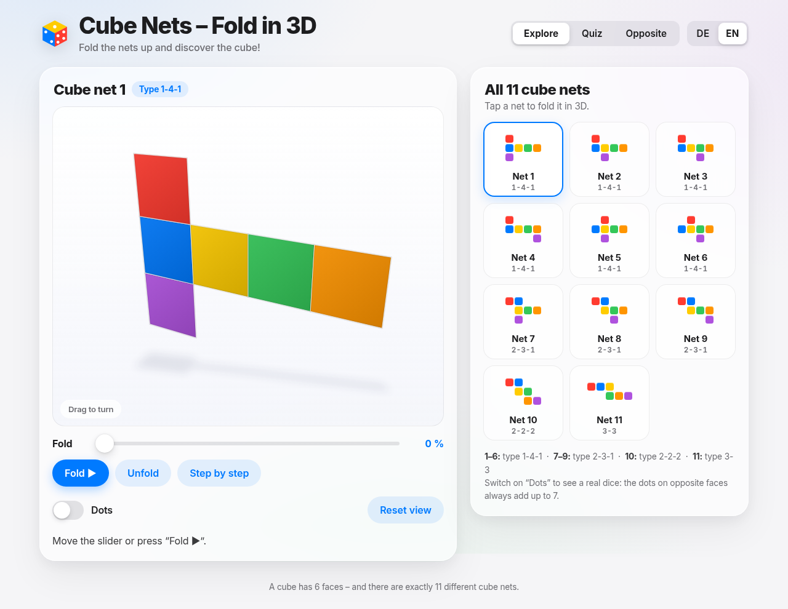

# Cube Nets – Fold in 3D

A small, offline learning app that shows all **11 nets of a cube** and folds each one into a cube in 3D.

**[▶ Open the app](https://frank-otto.github.io/cube-nets-3d/)**

## Features
- All 11 cube nets (1-4-1, 2-3-1, 2-2-2, 3-3); fold with a slider, as an animation, or step by step
- Spin the cube with mouse or finger
- Optional dots: opposite faces always add up to 7
- Quiz "Cube net or not?" – uses all 24 six-square shapes that can't fold; folding shows where two faces overlap
- "Which face is opposite?" mode
- German & English switch
- One single HTML file, works fully offline, no tracking, no external libraries

## Verified
All 35 hexominoes were checked programmatically: exactly 11 fold into a cube, with each of the 6 cube faces covered exactly once.

## Run locally
Download `index.html` and open it in any modern browser.

Built with SI.
